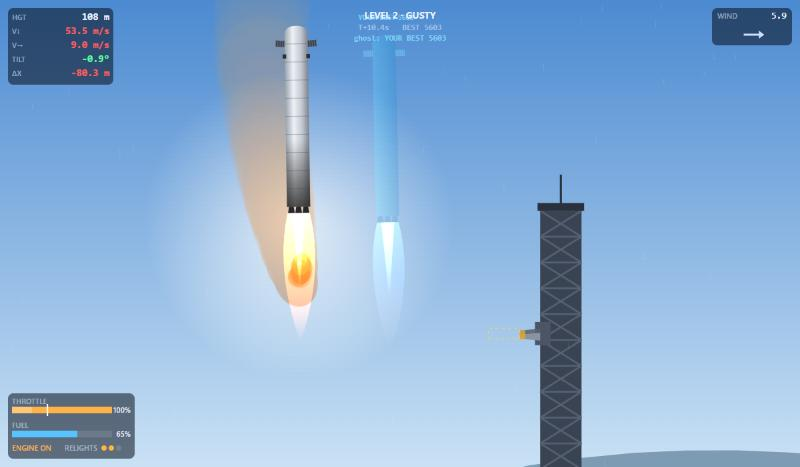
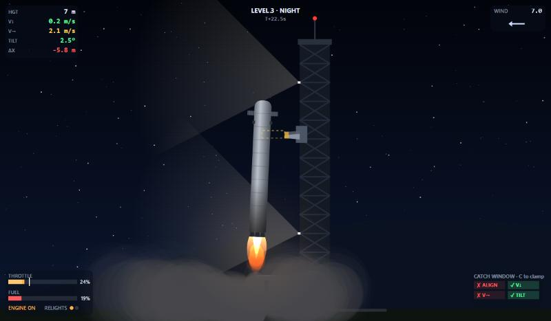
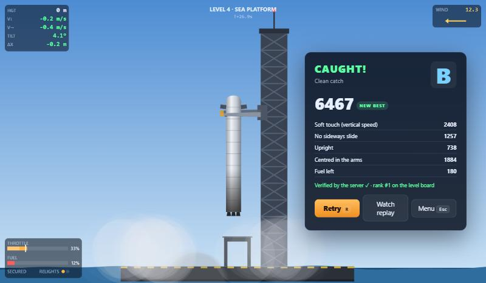
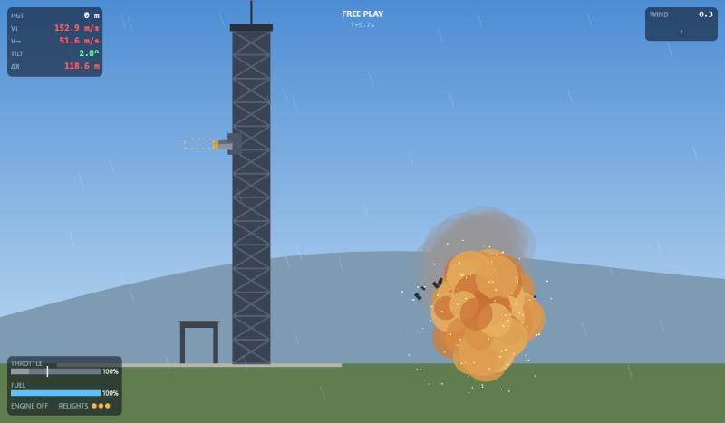
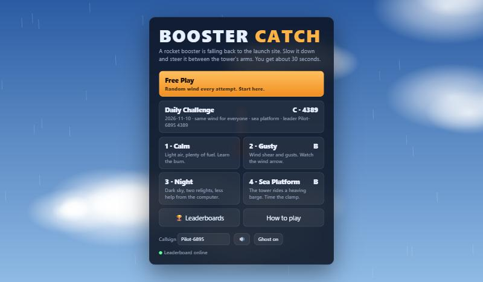
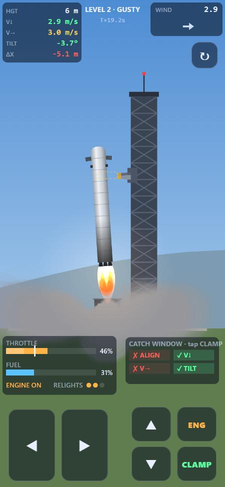
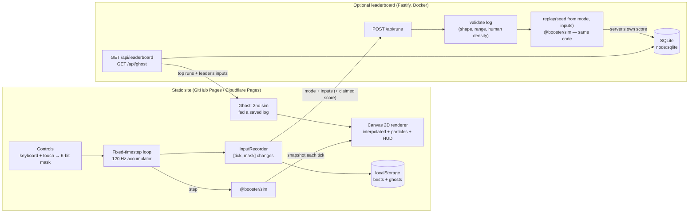

# Booster Catch

[](https://github.com/wallaceandrew9331-create/booster-catch/actions/workflows/ci.yml)

**[▶ Play it in your browser](https://wallaceandrew9331-create.github.io/booster-catch/)**. Works on desktop and phones. The hosted build is offline-only for now (local bests and ghosts, no leaderboard).

A rocket booster is falling back to the launch site at 150 m/s. Steer it with grid fins, light the engine at the right moment, and ease it between the launch tower's catch arms. A run takes about 30 seconds, and **R** restarts instantly.

Under the game is a **deterministic simulation**. The same seed and the same input log reproduce a run bit for bit, in the browser or in Node. That one property drives three features:

- **Ghost replays.** Race a translucent copy of your best run, or of today's #1 player.
- **Watch replay.** Every run can be re-watched from its input log alone (a few KB).
- **Cheat-resistant leaderboard.** Clients submit inputs, never scores. The server re-simulates the run with the same TypeScript sim and computes the score itself.



| | |
|---|---|
|  |  |
|  |  |



## How to play

| Keyboard | Touch | Action |
|---|---|---|
| A / D or ← / → | ◀ ▶ | Steer. Grid fins while falling, engine gimbal when lit. |
| W / S or ↑ / ↓ | ▲ ▼ | Throttle. It can't drop below 20% once lit. |
| Space | ENG | Engine on or off. Relights are limited (3, or 2 on hard levels). |
| C | CLAMP | Close the arms yourself for a +1000 bonus. They auto-close when you're lined up and slow. |
| R (Shift+R: same wind) | ↻ | Instant restart |
| G / M / Esc | | Toggle ghost, mute, menu |

1. **Fall.** Hold a steering key to glide toward the tower on the fins. You start 120–320 m out.
2. **Burn.** Hit Space when the HUD flashes **LIGHT ENGINE**. It works out your stopping distance for you.
3. **Approach.** Keep the top-left numbers green. The white tick on the throttle bar is hover throttle for your current mass.
4. **Catch.** When all four CATCH WINDOW checks are green, the arms close. Press C a little early to earn the bonus.

A catch is graded on vertical speed, sideways drift, tilt, alignment with the arms and fuel left: S ≥ 8500, A ≥ 7000, B ≥ 5000. Arriving a bit too hot gives a **wobble**: caught at half points. Arriving much too hot ends in an explosion with particles and screen shake.

**Modes**

- **Free Play:** new random wind every attempt, maximum flight-computer assist.
- **Daily Challenge:** the wind, start position and conditions (some days are at night, some at sea) come from the UTC date, so everyone flies the same run. It has its own leaderboard and a leader ghost.
- **Levels:** 1 Calm → 2 Gusty → 3 Night → 4 Sea Platform, where the tower rides a heaving barge. Each level unlocks the next. Assist and relights shrink as you go.

The game is fully playable offline. If the leaderboard server is down (or the build has no server URL), it keeps local bests and ghosts in `localStorage`.

## Architecture



```
packages/sim     pure TypeScript simulation: no DOM, no clock, no Math.random. Shared by both apps.
apps/web         Vite + Canvas 2D game client (vanilla TS, no framework)
apps/server      Fastify API + SQLite, bundled to one file by esbuild
```

## Running it

Needs Node 22.13+ (for `node:sqlite`).

```bash
npm install
```

```bash
npm run dev
```

That's the game at http://localhost:5180. In a second terminal, start the leaderboard:

```bash
npm run dev:server
```

The server runs at http://localhost:8787. Dev builds point at it via `apps/web/.env.development`.

```bash
npm test
```

That runs the 59 Vitest tests: sim, determinism, server verification and HTTP.

```bash
npm run lint && npm run typecheck && npm run build
```

```bash
npm run sim:sweep -- 500
```

That flies the autopilot through 500 seeds per mode and prints outcome mixes (the tuning tool).

Docker (server only):

```bash
docker compose up --build
```

## Design decisions

### Determinism: what it takes, and where it stops

A replay is `(mode, input log)`. The mode fixes the seed, and the log is a run-length list of `[tick, mask]` integers. For the replay to reproduce the run, every arithmetic operation in the sim must give the same bits on every machine. JavaScript helps more than C++ here.

- **Basic float ops are exact.** ECMAScript requires `+ - * /` to be correctly rounded IEEE-754 doubles, with no fused multiply-add contraction and no x87 80-bit intermediates. `Math.sqrt` is correctly rounded by IEEE 754 and every engine uses the hardware instruction. The integer ops behind the PRNG (`Math.imul`, shifts) are exact.
- **Transcendentals are not.** The spec calls `Math.sin`, `cos`, `exp`, `pow`, `atan2` and `hypot` *implementation-approximated*: V8, SpiderMonkey and JavaScriptCore can differ in the last bit, and one bit at tick 200 is a different landing at tick 3000. So the sim never calls them. [`dmath.ts`](packages/sim/src/dmath.ts) builds `sin`/`cos` from a range-reduced Taylor polynomial using only `+ - * /`. Air density uses a rational approximation instead of `exp`. An ESLint rule bans the unsafe `Math` functions, `Math.random`, `Date` and timers inside `packages/sim/src`.
- **The clock never touches the sim.** It's stepped a whole tick at a time (`DT = 1/120`). The sea platform's heave is a closed-form function of `tick`, not an accumulated phase, so it can't drift.
- **The inputs contain no floats.** A 6-bit mask per tick means JSON round-trips are exact and the server sees one of 64 values per tick: there is no analog stick value to forge.
- **Tests pin it.** One test replays a recorded live run and compares a 64-bit hash of every state field. Another flips one input bit and expects a different hash. A golden-hash test pins the end state of three runs for the current `SIM_VERSION`. CI runs the sim tests on Node 22 and Node 24.

**Limits.** CI runs V8 only. I've verified the design reasoning and the golden hashes on V8, not on SpiderMonkey or JavaScriptCore. The next step would be running the golden test in Firefox and Safari via Vitest browser mode. Any physics change invalidates old replays by design, so `SIM_VERSION` is stamped on every saved ghost and submission, and the server rejects mismatches with a "please reload" error. Determinism also only covers the sim: particles, camera shake and audio use `Math.random` freely, because nothing flows back from them into gameplay.

### Why re-simulation beats trusting client scores

Anything the browser computes, a player can change. Sending a score means anyone with devtools can post 10,000. Signing the score doesn't help either, because the signing key ships in the same JavaScript. So the server is given the *cause* (inputs), never the *effect* (score):

1. **Cheap rejection first.** [`validateLog`](packages/sim/src/replay.ts) checks shape, integer ranges, strict tick order, a 90 s cap, and at most 40 input changes in any one-second window. A bot flipping keys every tick (120 changes/s) is rejected before any physics runs.
2. **Re-simulation.** The server rebuilds the seed from the mode itself (the date or level id, never a client-sent seed) and steps the same `@booster/sim` code. The score is whatever the sim says. A claimed score is compared afterwards, so a tampered log produces a clear "score mismatch" error. Inputs that continue after the run ended are rejected too.
3. **Ranked modes only.** Free play lets the client choose the seed, so someone could search for an easy one. Only daily and level runs, whose seeds the server derives, go on the boards.
4. **Cost control.** One verification is about 3,000 sim ticks, roughly 10 ms of CPU (measured in the server logs). Submissions are rate-limited to 12/min per IP, reads to 240/min, and request bodies to 256 KB.

**What this doesn't stop:** a tool-assisted run. Someone can still write their own autopilot (this repo has one), search offline for great inputs and submit them. They'd be real, physically valid runs. Re-simulation proves a score is consistent with the physics, not that a human produced it. Mitigations I'd add for a public launch: a server-secret salt in the daily seed (an HMAC of the date, revealed on the day), so runs can't be pre-computed, at the cost of the daily needing the server; per-run nonces; and statistical review of top logs.

### Fixed timestep + interpolation

The browser hands you frames at 60, 120, 144 Hz or whatever the display does, with jitter. Stepping physics by the frame time makes the outcome depend on the monitor. The game uses an accumulator instead ([`game.ts`](apps/web/src/game.ts)):

```
acc += min(frameTime, 0.25)        // clamp: a stalled tab can't fast-forward seconds of physics
while (acc >= DT) { step(sim, input); acc -= DT }
render(lerp(prevSnapshot, currSnapshot, acc / DT))
```

Physics always runs at exactly 120 Hz, which is what makes replays line up. Rendering interpolates between the last two ticks, so motion stays smooth on any refresh rate at the cost of up to one tick (8.3 ms) of display latency. Input is sampled once per tick, and quick taps are latched so a press shorter than a tick is never lost.

### Integrator and model

Semi-implicit (symplectic) Euler: update velocity first, then position with the new velocity. It costs the same as explicit Euler and doesn't pump energy into the spring-like attitude hold. The model is deliberately small: thrust along the body axis, quadratic drag split into slim end-on and fat broadside components, grid-fin lift proportional to dynamic pressure, wind shear (piecewise-linear layers by altitude) plus seeded gusts that ease toward random targets, and a flight-computer assist (rate damping plus attitude spring) whose strength is a per-level knob.

### Rendering: Canvas 2D

Each frame draws a few hundred vector shapes and up to 2,500 particles, with no textures or shaders that would need the GPU pipeline. Canvas 2D handles that comfortably, adds zero dependencies and keeps every draw call readable. PixiJS or WebGL would earn its place with thousands of sprites or post-processing. The world uses a transform where 1 unit is 1 metre and y points up, matching the sim, so drawing code reads like the physics. Only the HUD works in screen pixels. Sound is all WebAudio synthesis: engine rumble follows throttle, the wind roar follows dynamic pressure, and there's no audio file to download.

### Tuning (from playtests)

I played the game in the browser and used the autopilot sweep (`npm run sim:sweep`) to check every mode stays catchable. Changes that came out of playtests:

| Problem found | Change |
|---|---|
| A light booster at 30% minimum throttle floated *upward* with no way down except burning a relight. It felt unfair, not hard. | `MIN_THROTTLE` 0.3 → 0.2. A near-empty booster now sinks at ~3 m/s² on minimum. |
| Lighting the engine at the obvious moment (~600 m) barely stopped in time; new players crashed without knowing why. | Thrust 2.4 g → 2.5 g, plus a HUD **LIGHT ENGINE** cue computed from stopping distance. The first ignition starts at full throttle. |
| Full-throttle steering was twitchy (a half-second tap overshot to 20° of tilt), while hover steering was mushy. | Gimbal torque scales with √thrust instead of linearly. |
| Grid fins couldn't cover a 250 m offset during the fall, so the whole fix happened under power and burned fuel. | Fin lift doubled. |
| Crosswind vanished exactly when it mattered: quadratic drag is about zero at hover. | A linear "floor" term in side drag keeps gusts pushing near the tower. |
| A tilted booster's engine end swung into the tower face. | Tower face moved out (10 → 14 m from the catch line). |
| Approaching over the tower meant threading past its top. | Boosters always start on the open side. |
| Results covered the catch. | The results card sits beside the action. The booster settles upright in the arms. |

Difficulty ramp: assist 1.0 / 0.8 / 0.45 / 0.35, relights 3 / 3 / 2 / 2, gusts 0 / 6 / 7 / 7 m/s for Calm → Sea. Daily conditions are drawn from the date in the Gusty-to-Sea range. In the final sweep the autopilot catches **500/500** free-play seeds (96% clean) and **97%** of 500 daily dates. Humans are the real test, and the autopilot's 20 Hz pulse steering is far from optimal play (its average score is a C/B), so there's plenty of room above it.

## Deploying

**Static game: GitHub Pages** (live at https://wallaceandrew9331-create.github.io/booster-catch/). [`.github/workflows/pages.yml`](.github/workflows/pages.yml) is manual-only (`workflow_dispatch`). Enable Pages with source "GitHub Actions", optionally set the repo variable `VITE_API_URL` to your server, then run the workflow. Vite's `base: './'` lets the build work under `/booster-catch/`.

**Static game: Cloudflare Pages.** Use build command `npm ci && npm run build -w @booster/web`, output directory `apps/web/dist`, and the env var `VITE_API_URL` (optional).

**Leaderboard server.** Any container host works. [`fly.toml`](fly.toml) is ready for Fly.io (`fly volumes create bc_data`, `fly secrets set CORS_ORIGIN=https://<you>.github.io`, `fly deploy`), and it scales to zero when idle. Env vars: `PORT`, `DB_PATH`, `CORS_ORIGIN` (comma-separated), `TRUST_PROXY=1` behind a proxy so rate limits key on the real client IP, and `SUBMIT_PER_MINUTE`.

## API

| Method | Path | Notes |
|---|---|---|
| GET | `/api/health` | `{ ok, simVersion }` |
| POST | `/api/runs` | `{ simVersion, mode, name, inputs, claimedScore }` → `{ accepted, score, rank }` or `4xx { error }` |
| GET | `/api/leaderboard?board=daily&date=YYYY-MM-DD` | also `board=alltime`, `board=level&id=calm` |
| GET | `/api/ghost?board=daily&date=…` | the leading run's input log, for the leader ghost |

## Credits

An original game by Andrew Wallace. The booster, tower and every name in it are generic and fictional. MIT licensed.
